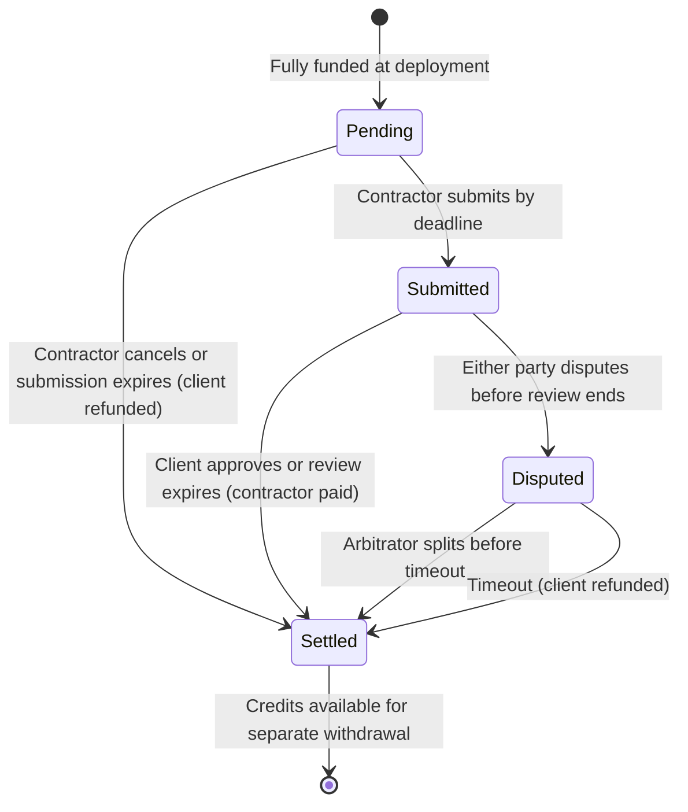

# Milestone Escrow

> [!NOTE]
> **This is a later variant, not the reference version.** The reference case study is **[milestone-escrow-verification](https://github.com/francodoneddu-ctrl/milestone-escrow-verification)**: same contract, same 100% coverage, with 8 fuzz properties and a hand-written mutation check (6 of 6 faults detected). This variant replaces two of its test files with a different suite (49 tests, 2 fuzz properties) and is kept for reference only.

### Solidity testing portfolio · Foundry · ETH escrow

A case study in turning business rules into executable checks: role permissions, exact deadline boundaries, payment accounting, and adversarial callbacks.

The contract holds payment for independent work milestones. The portfolio focuses on **how the behavior is specified and verified**, with source code, tests, raw results, and explicit limits available for review.

[](https://github.com/francodoneddu-ctrl/milestone-escrow/actions/workflows/test.yml)

**49 checks passed · 0 failed · 0 skipped**, locally and on GitHub Actions. This is a test result, not an audit certification.

[Read the specification](docs/SPECIFICATION.md) · [Inspect the contract](src/MilestoneEscrow.sol) · [Review the evidence](docs/VERIFICATION.md)

## Start here

| If you want to assess… | Read… |
|---|---|
| Business rules and permissions | [Specification and transition table](docs/SPECIFICATION.md) |
| Source clarity and payment handling | [MilestoneEscrow.sol](src/MilestoneEscrow.sol) |
| Unit tests and parameter fuzzing | [MilestoneEscrow.t.sol](test/MilestoneEscrow.t.sol) |
| Stateful model-based properties | [EscrowInvariant.t.sol](test/EscrowInvariant.t.sol) |
| Callback settlement and rollback | [CallbackReentrancy.t.sol](test/CallbackReentrancy.t.sol) |
| Constructor and boundary cases | [ConstructorEdgeCases.t.sol](test/ConstructorEdgeCases.t.sol) |
| Wrong-state transition guards | [StateGuards.t.sol](test/StateGuards.t.sol) |
| Results, assumptions and remaining gaps | [Verification report](docs/VERIFICATION.md) |

## The problem

An escrow must do more than transfer ETH on approval. It needs defined answers when work is late, a reviewer is silent, a dispute is unresolved, or a payment recipient executes code during withdrawal.

This implementation makes those decisions explicit. A client funds all milestones at deployment; a contractor submits deliverable hashes; an arbitrator can split disputed amounts. Settlement creates credits. Beneficiaries withdraw separately to a recipient they choose.

## Lifecycle



Milestones are independent and may complete out of order. The review window is fixed at deployment (1 hour–30 days); arbitration lasts seven days from dispute. Maximum: 32 milestones.

**Important policy:** if the arbitrator does not resolve a dispute in time, the client receives the full refund. This favors the client and can disadvantage the contractor. Tests verify implementation of this rule; they do not establish fairness or arbitrator honesty.

## Engineering demonstrated

- **Specification-driven checks:** transitions, roles, and inclusive/exclusive time boundaries are stated before being tested.
- **Accounting properties:** funded ETH is partitioned into unallocated funds, outstanding credits, and completed withdrawals.
- **Independent model:** the stateful harness tracks awards, refunds and payments separately from the contract's aggregate counters.
- **Adversarial interactions:** rejecting recipients, nested withdrawal attempts, settlement inside a callback, and rollback after a callback reverts.
- **Review follow-through:** findings and tests from an independent static review were integrated and executed locally with the original suite. See [the follow-up](docs/VERIFICATION.md#review-follow-up-claude-tests-executed-locally).
- **Coverage gaps closed, not ignored:** the four branch outcomes missing from coverage were traced to untested wrong-state guards and closed with dedicated tests. See [the state-guard follow-up](docs/VERIFICATION.md#state-guard-follow-up-full-branch-coverage).

A tested accounting property:

```text
totalFunded = totalUnallocated + totalCredits + totalWithdrawn
```

Contract balance must cover outstanding liabilities; extra unsolicited ETH does not create credits.

## Recorded verification

| Check | Result |
|---|---|
| Deterministic tests | 44 passed |
| Parameter fuzz properties | 2 passed; 1,000 cases each |
| Stateful invariant properties | 3 passed; 256 sequences × depth 64 per property |
| Total Foundry checks | 49 passed, 0 failed, 0 skipped |
| Contract line coverage | 100% — 98/98 |
| Contract branch coverage | 100% — 28/28 |
| Contract statement coverage | 100% — 141/141 |
| Contract function coverage | 100% — 13/13 |

Recorded on 21 November 2026 with seed `0x42`. Invariants use the same seed; handler calls can be no-ops when preconditions are not met. Coverage measures execution, not completeness of behavior or proof of security.

[Raw test output](evidence/test-run.txt) · [Raw coverage output](evidence/coverage.txt) · [File hashes](evidence/SHA256SUMS.json)

## Run locally

Use **Foundry v1.4.4**, **Solidity 0.8.28**, Cancun EVM, optimizer 200 runs. The pinned forge-std source snapshot is included; no dependency initialization is needed.

From the repository root:

```sh
# First build downloads Solidity 0.8.28 if it is not installed.
forge build

# Subsequent verification can run offline.
forge test --offline --fuzz-seed 0x42
forge coverage --offline --fuzz-seed 0x42 --report summary
forge fmt --check
```

For an existing local compiler, append `--use /absolute/path/to/solc-0.8.28` to build/test/coverage commands. All tests run in-process without an RPC endpoint, wallet, private key, or public deployment.

The [GitHub Actions workflow](.github/workflows/test.yml) runs the same format check, tests and coverage on every push; see the [run history](https://github.com/francodoneddu-ctrl/milestone-escrow/actions).

## Scope and limits

This is an **AI-assisted portfolio case study, not an independently audited production product**. It demonstrates testing work that can be inspected and reproduced.

- An off-chain hash does not prove delivery quality or availability.
- Arbitrator selection, consent, honesty and availability remain external responsibilities.
- Client and contractor must be capable of invoking `withdraw(recipient)`, including when they are contracts.
- Forced ETH surplus is not recoverable in this version.
- Arbitrary smart-account callback sequences, formal proofs and exhaustive configuration fuzzing are outside the completed review.
- There are no fees, upgrades, ERC20 payments, or admin rescue functions.

See [the full verification limits](docs/VERIFICATION.md#limits-and-next-review-priorities) before interpreting the results. No real funds or public deployment were used.

## Tooling and provenance

Production Solidity has no external imports. Tests use a vendored [forge-std snapshot](https://github.com/foundry-rs/forge-std/tree/60acb7aaadcce2d68e52986a0a66fe79f07d138f), with upstream licenses retained. Implementation and testing were assisted by Codex; Claude supplied a separate static review and additional tests. Execution results were recorded locally after integrating those tests.

References: [Solidity security considerations](https://docs.soliditylang.org/en/v0.8.28/security-considerations.html) · [Foundry v1.4.4](https://github.com/foundry-rs/foundry/releases/tag/v1.4.4).

## Author

Francesco Doneddu — Solidity test engineering and smart-contract hardening.
GitHub: [@francodoneddu-ctrl](https://github.com/francodoneddu-ctrl)

Available for test-suite development (unit, fuzz, invariant, reentrancy) on existing Solidity codebases.

## License

Project source: [MIT](LICENSE). Vendored dependencies retain their own licenses.
